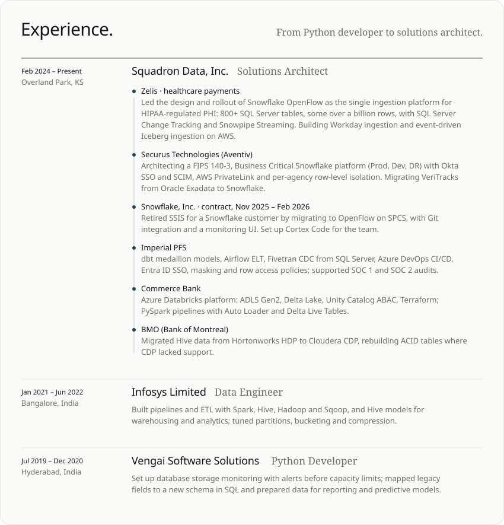

<!-- Profile README for github.com/srikanthpinisetti, styled after datacrate360.com: dark hero, light sections, a dark feature band and a dark footer. Cards are in ./assets. -->

  

  &nbsp;
  &nbsp;
  &nbsp;
  

<!-- PROJECTS:START -->

  
  

<!-- PROJECTS:END -->

  &nbsp;
  

  

